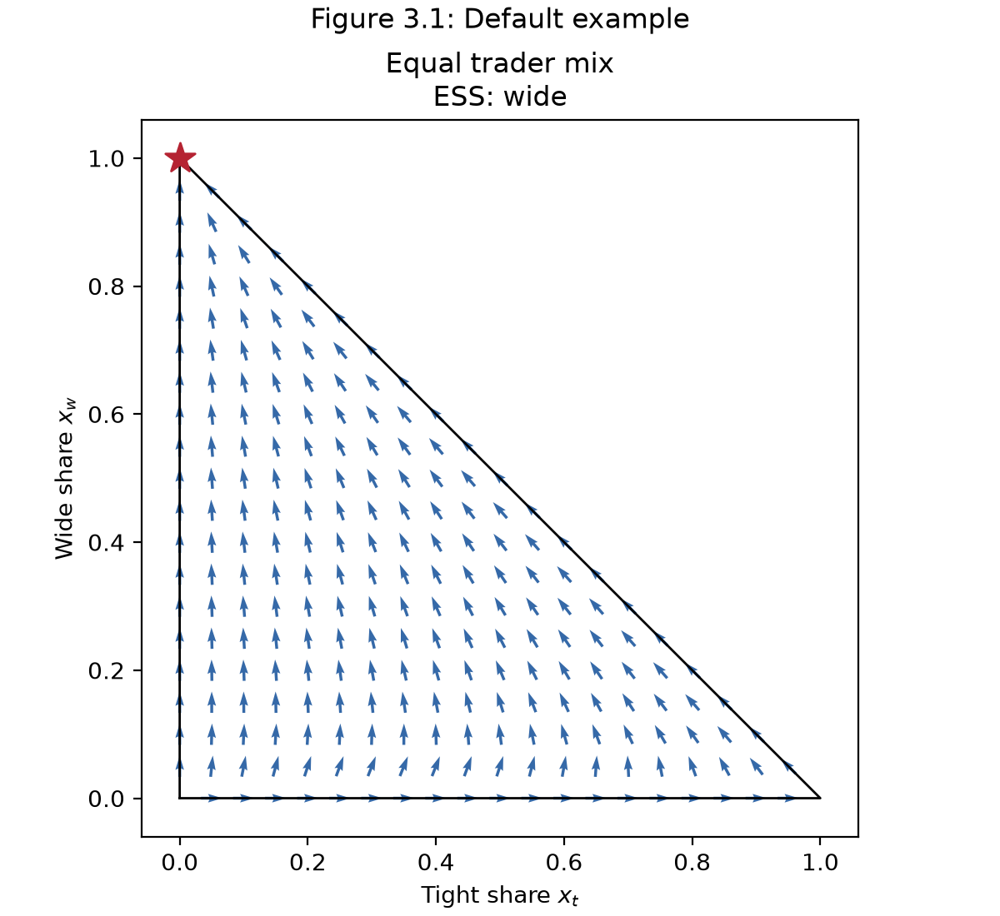
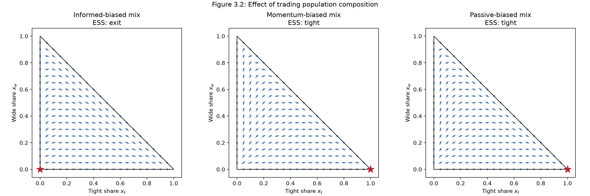
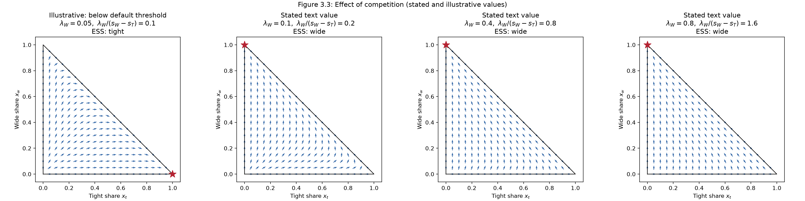
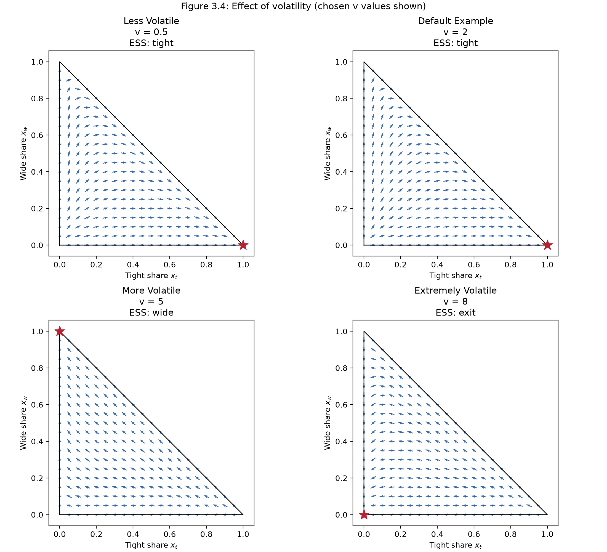

# market-making-egt

Replicator dynamics and finite-population (Moran) fixation probabilities for an evolutionary game between market makers and traders, re-implementing the numerical analysis of a Dartmouth Math 30.04 paper.

## Context

This script re-implements the numerical analysis in "Modeling Market Making Behavior Using Evolutionary Game Theory," a Dartmouth Math 30.04 paper I co-authored with Parker Tomlinson, Adeoluwawumi Adedoyin and Tuan Ha (also my writing sample). Market makers choose tight spreads, wide spreads or exit against informed, momentum and passive traders. The code builds both players' payoff matrices, evaluates the replicator dynamics, draws slope fields across trader mixes, competition and volatility, and computes Moran fixation probabilities for 500 firms, checking all 18 values the paper reports. Reproducing the figures showed that the competition values stated in the text do not produce the paper's Figure 3.3; the code flags this. The model comes from our paper. I wrote this script with AI assistance: Claude drafted the outline and docstrings, and Codex helped test it and run the numerical checks.

## Quick start

Requires Python 3.10 or newer (tested with Python 3.11.6, numpy 2.4.6 and matplotlib 3.11.2).

```bash
python3 -m pip install -r requirements.txt
python3 market_making_egt.py
```

A run takes a few seconds and:

1. runs `run_checks()` and prints one `PASS` line per check (it stops with an error if any check fails);
2. writes four PNG figures (200 dpi) to `figures/` next to the script, creating the folder if needed;
3. prints a note on Figure 3.3 (see [below](#note-on-figure-33));
4. prints, for the equal, informed-, momentum- and passive-biased trader mixes, the six fixation probabilities $\rho_{A/B}$, whether each exceeds the neutral value $1/N = 0.002$, and the finite-population ESS.

## Model in brief

**Players.** Market makers choose a tight spread, a wide spread or exit, with population shares $x_t, x_w, x_c$. Traders are informed, momentum or passive, with shares $y_i, y_m, y_p$. As in the paper (Section 2.3), the trader mix is held fixed so the market-maker dynamics can be drawn on a 2-D simplex.

**Default parameters** (paper Section 3.1.1):

| Symbol | Meaning | Default |
|---|---|---|
| $s_T$ | spread revenue per interaction, tight | 2.0 |
| $s_W$ | spread revenue per interaction, wide | 2.5 |
| $\lambda_T$ | volume multiplier, tight | 1.0 |
| $\lambda_W$ | volume multiplier, wide | 0.4 |
| $a$ | adverse-selection edge of informed traders | 5.0 |
| $v$ | market volatility | 2.0 |
| $\beta$ | momentum edge per unit of volatility | 0.45 |
| $c_f$ | information cost, informed traders | 3.5 |
| $c_m$ | active-management cost, momentum traders | 0.5 |

Trader mixes: equal $(1/3, 1/3, 1/3)$, or 2/3 to one type and 1/6 to each of the other two (informed-, momentum- or passive-biased).

**Payoffs.** A quoting market maker earns its spread minus the trader's edge ($a$ against informed traders, $\beta v$ against momentum traders, nothing against passive traders), all scaled by its volume multiplier. Exiting earns zero. Each trader's payoff is the negative of the market maker's minus its own cost ($c_f$, $c_m$ or 0), which is paid even when market makers exit. At the defaults the market-maker payoff matrix (rows tight, wide, exit; columns informed, momentum, passive) is

```math
A_{mm} = \begin{pmatrix} -3 & 1.1 & 2 \\ -1 & 0.64 & 1 \\ 0 & 0 & 0 \end{pmatrix}.
```

**Replicator dynamics** (equations 8-10), with fitness vector $f = A_{mm} y$ and average fitness $\phi = x \cdot f$:

```math
\dot{x}_k = x_k \,(f_k - \phi), \qquad k \in \{t, w, c\}.
```

**Finite population** (paper Section 3.5.1). A Moran birth-death process with $N = 500$ firms and reproductive fitness $F = 1 + w f$, $w = 0.06$. The probability that one mutant $A$ takes over a resident population of $B$ is

```math
\rho_{A/B} = \frac{1 - 1/r}{1 - r^{-N}}, \qquad r = F_A / F_B,
```

with neutral value $1/N = 0.002$. Following Section 3.6, a strategy counts as a finite-population ESS if no single mutant is favored over neutral drift when invading it: $\rho_{B/A} < 1/N$ for every other strategy $B$. The code evaluates the formula with `log1p`/`expm1`, which avoids cancellation when $r$ is close to 1, and rewrites the $r < 1$ case to avoid overflow.

**Reduction to a single edge.** Market-maker fitness depends on the trader mix only through the edge $e = y_i a + y_m \beta v$, since $f_k = \lambda_k (s_k - e)$ for the tight and wide spreads and $f_c = 0$. With a fixed trader mix, fitness does not depend on $x$, so from any interior starting point the dynamics go to the vertex of the highest-fitness strategy, and (when that strategy is unique) it is also the finite-population ESS. With the default spreads and volume multipliers this gives one rule: tight if $e < 5/3$, wide if $5/3 < e < 5/2$, exit if $e > 5/2$.

## Results

The finite-population ESS matches the paper in all three cases: **exit** in the informed-biased market, **tight** in the momentum-biased market and **tight** in the passive-biased market. (The script also prints the equal mix, where the finite-population ESS is wide, the strategy the paper's Section 3.1.3 gives as the ESS for Figure 3.1.)

Fixation probabilities $\rho_{A/B}$ (mutant $A$, resident $B$; t = tight, w = wide, c = exit), $N = 500$, $w = 0.06$. Code values are rounded to 3 significant figures; paper values are from Section 3.6.

| A/B | Informed: code | Informed: paper | Momentum: code | Momentum: paper | Passive: code | Passive: paper |
|---|---|---|---|---|---|---|
| t/w | 6.33e-17 | 6.33e-17 | 0.00826 | 0.00826 | 0.0232 | 0.0232 |
| t/c | 5.61e-22 | 5.61e-22 | 0.0329 | 0.0329 | 0.0575 | 0.0575 |
| w/t | 0.0670 | 0.0670 | 1.41e-4 | 1.41e-4 | 1.91e-7 | 1.91e-7 |
| w/c | 1.57e-7 | 1.57e-7 | 0.0250 | 0.0250 | 0.0351 | 0.0351 |
| c/t | 0.0890 | 0.0890 | 1.87e-9 | 1.87e-9 | 8.47e-15 | 8.47e-15 |
| c/w | 0.0236 | 0.0236 | 8.30e-8 | 8.30e-8 | 6.27e-10 | 6.27e-10 |

All 18 values agree to 3 significant figures; the largest relative difference before rounding is 0.29% (informed, w/c).

### Figures

Each panel shows the direction of the replicator flow on the $(x_t, x_w)$ plane, with $x_c = 1 - x_t - x_w$; arrows have equal length, and a star marks the ESS vertex.



*Figure 3.1. Default parameters, equal trader mix: wide spreads are the ESS.*



*Figure 3.2. Informed-, momentum- and passive-biased mixes: exit, tight and tight are the ESS.*



*Figure 3.3. Equal mix, competition decreasing from left to right: an illustrative $\lambda_W$ = 0.05 panel that converges to tight, then the values stated in the paper's text, $\lambda_W$ = 0.1, 0.4, 0.8, which all converge to wide. See the [note below](#note-on-figure-33).*



*Figure 3.4. Momentum-biased mix at v = 0.5, 2, 5, 8: tight, tight, wide, exit.*

The paper does not list the volatility values it plotted, so the script uses 0.5, 2, 5 and 8 to span the three regimes. In the momentum-biased mix, $e = 5/6 + 0.3v$, so tight spreads win for $v < 25/9 \approx 2.78$, wide spreads for $25/9 < v < 50/9 \approx 5.56$, and exit above $50/9$.

## Note on Figure 3.3

With the $\lambda_W$ values stated in the paper's text (0.1, 0.4, 0.8) and the equal trader mix, wide spreads have the highest fitness in every panel, so these values do not reproduce the paper's Figure 3.3, whose "More Competitive" panel converges to tight spreads. Under the equal mix at the other default parameters, $e = 59/30$, so

```math
f_t = 1 \cdot (2 - 59/30) = 1/30 \quad \text{(independent of } \lambda_W\text{)}, \qquad f_w = \lambda_W \,(5/2 - 59/30) = \tfrac{8}{15}\,\lambda_W,
```

and tight spreads win only when $\lambda_W < 0.0625$. The script plots an illustrative $\lambda_W$ = 0.05 panel first to show this case, then the three stated values, and prints a note when it runs.

## Verification

`run_checks()` runs before any figure is drawn and asserts that:

- **Payoff matrices.** Both 3x3 matrices at the default parameters equal hard-coded values: the market-maker matrix printed in the paper's Section 3.5.1, and the trader matrix from the Section 2.1 payoffs (the paper gives that one only in symbolic form).
- **Equations 11-13.** The general replicator implementation agrees with the paper's closed-form default-parameter dynamics, typed in separately, at the 15 points of a 4-step simplex grid and 20 random interior points for all four trader mixes, within `numpy.testing.assert_allclose` tolerances (absolute 1e-14 plus the default relative 1e-7).
- **Conservation.** At the same points and mixes, the three components of $\dot{x}$ sum to zero within an absolute 1e-14, so the total share stays at 1.
- **Neutral drift.** Equal fitness gives $\rho = 1/500$ exactly.
- **Paper values.** All 18 fixation probabilities in Section 3.6 are reproduced within 1% relative error, with no absolute tolerance, so a tiny value such as 5.61e-22 cannot pass as zero.
- **ESS cases.** The finite-population ESS is exit, tight and tight for the informed-, momentum- and passive-biased mixes.
- **Numerical stability.** $\rho$ for $r = 1/2$ and $N = 500$ matches $2^{-500}$ to a relative 1e-12, and a fitness one floating-point step above neutral still gives $1/N$ to a relative 1e-12.
- **Monte Carlo cross-check.** A seeded simulation of the Moran birth-death process (tight mutant against wide residents in the momentum-biased mix, $N = 20$, $w = 0.5$, 5,000 trials) agrees with the closed-form $\rho$ within 4 standard errors.

<!-- TODO(Minh): keep this list in sync with run_checks() if checks are added or removed (it reflects the code as of 2026-10-04). -->

## Repository structure

```text
market-making-egt/
  market_making_egt.py   model, slope fields, Moran analysis, checks (single file)
  requirements.txt       numpy and matplotlib minimum versions
  figures/               PNGs written by the script (Figures 3.1-3.4)
  README.md
  .gitignore
```

`market_making_egt.py` has seven numbered sections. The first five follow the paper's order: (1) parameters, (2) payoffs and fitness, (3) replicator dynamics, (4) slope fields, (5) Moran process. They are followed by (6) checks against the paper and (7) `main()`.

## Authorship and AI assistance

The model, its parameters and the paper's results come from our group paper, written with Parker Tomlinson, Adeoluwawumi Adedoyin and Tuan Ha. This script re-implements the paper's numerical analysis. The edge thresholds above and the threshold calculations for Figures 3.3 and 3.4 are additions in this repository, not results stated in the paper. I wrote this script with AI assistance: Claude drafted the outline and docstrings, and Codex helped test it and run the numerical checks.

## Paper

Parker Tomlinson, Adeoluwawumi Adedoyin, Minh Nguyen and Tuan Ha. "Modeling Market Making Behavior Using Evolutionary Game Theory." Math 30.04 final paper, Dartmouth College, June 2026.

<!-- TODO(Minh): add a link to the paper PDF here if you decide to post it. -->
